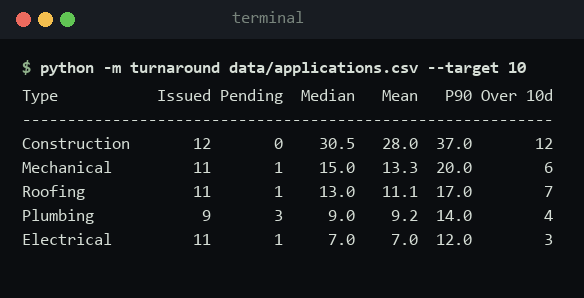

<p align="center"></p>

# permit-turnaround-calculator

[](https://github.com/yassine2med/permit-turnaround-calculator/actions/workflows/ci.yml)  

Reads permit applications from CSV and reports turnaround in business days per permit type.



## What it is for

Permit offices and project teams quote turnaround in calendar days, which hides weekends and holidays. A project engineer, construction scheduler or facility planner uses this tool to see how long each permit type really takes. For each type they get the median, mean, 90th percentile, pending count and how many missed a target, which helps set realistic permit lead times in a schedule.

## Install

```
git clone <repo-url> permit-turnaround-calculator
cd permit-turnaround-calculator
pip install -e .
```

Python 3.10 or newer. No dependencies.

## How to use

| I want to | Command |
|---|---|
| Report turnaround with the default target of 15 business days | `python -m turnaround data/applications.csv` |
| Set the target in business days | `python -m turnaround data/applications.csv --target 10` |
| Exclude a holiday (repeat the option for more) | `python -m turnaround data/applications.csv --holiday 2026-01-19` |
| See the built-in help | `python -m turnaround --help` |
| Run the tests | `python -m pytest -q` |

The CSV needs permit_id, type, applied and issued (YYYY-MM-DD). A blank issued value means pending.

Worked example:

```
python -m turnaround data/applications.csv --target 10
```

```
Type           Issued Pending  Median   Mean   P90 Over 10d
-----------------------------------------------------------
Construction       12       0    30.5   28.0  37.0       12
Mechanical         11       1    15.0   13.3  20.0        6
Roofing            11       1    13.0   11.1  17.0        7
Plumbing            9       3     9.0    9.2  14.0        4
Electrical         11       1     7.0    7.0  12.0        3
```

## How it works

- Business days count each weekday after the applied date up to and including the issued date.
- `--holiday YYYY-MM-DD` (repeatable) removes extra days.
- Statistics use only issued permits. Pending permits are counted separately.
- `--target N` counts issued permits that took more than N business days.

## Limits

Pending permits are not aged, so the numbers describe finished work only. Holidays must be passed by hand. The sample data is synthetic.

## License

MIT. Copyright 2026 Yassine Emhamed.
